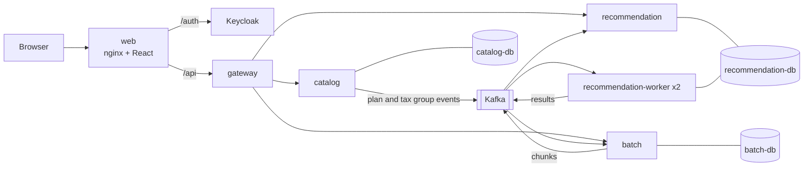

# GridWise

GridWise recommends the cheapest electricity billing plan for a customer's monthly consumption. Administrators maintain versioned
plans and tax groups; customers calculate, compare and accept a plan; administrators can also price a whole CSV of customers in the
background. It is a .NET 10 microservice system with a React client, PostgreSQL per service, Kafka between services and Keycloak for login.

## Architecture



| Container | Responsibility |
|---|---|
| `web` | nginx serving the React app; proxies `/api` to the gateway and `/auth` to Keycloak, so the browser sees one origin |
| `gateway` | YARP reverse proxy: checks the token, rate limits per user, sets a correlation id, routes `/api/<service>/*` |
| `catalog` | Source of truth for plans and tax groups. A change adds an immutable version; an outbox publishes it to Kafka |
| `recommendation` | Prices every plan from its own copy of the catalog (filled from Kafka), recommends the cheapest, stores recommendations and acceptances |
| `recommendation-worker` | The recommendation image in worker mode (2 replicas): prices batch chunks from the same copy |
| `batch` | Accepts a CSV, splits it into chunks of 500 rows, tracks progress (server-sent events), serves result and error CSVs |
| `keycloak` | OpenID Connect provider, realm `gridwise` imported from [`keycloak/realm-gridwise.json`](keycloak/realm-gridwise.json) |
| `kafka` | One broker, 7 topics, a SASL/SCRAM login and ACLs per service |
| `otel-lgtm` | Grafana with Tempo, Loki and Prometheus: traces, logs, metrics, a dashboard and alert rules |

The pricing rules are a library (`GridWise.Pricing`) without database or messaging dependencies. Services never call each other
synchronously and never read another service's database. Details: [docs/architecture](docs/architecture/README.md) (containers,
topics, background services), [flows](docs/architecture/flows.md) (sequence diagrams), [data model](docs/architecture/data-model.md).

## Quick start

**Requirements:** Docker with Compose v2 and about 6–8 GB of memory for Docker. The ports 5100–5104, 3000, 5432–5434 and 9094 must be free.
Tested on Linux (amd64) and macOS (arm64, Apple M4 Pro).

```bash
docker compose up -d --build --wait
```

The first start takes about 5 minutes (image downloads and builds), later starts about 1 minute. `--wait` returns when every
service is healthy.

| URL | What |
|---|---|
| http://localhost:5100 | The app (and Keycloak under `/auth`) |
| http://localhost:3000/d/gridwise | Grafana dashboard (no login, admin access: local use only) |
| http://localhost:5101, 5102, 5103 | catalog, recommendation, batch, directly; API reference at `/scalar`, OpenAPI at `/openapi/v1.json` |
| http://localhost:5104 | gateway, directly |
| localhost:5432, 5433, 5434 | PostgreSQL of catalog, recommendation, batch (user and database named after the service, password `<service>_dev_pw`) |
| localhost:9094 | Kafka (SASL/SCRAM, see [docs/events](docs/events/README.md#security-users-and-permissions)) |

The services' own ports are for debugging: the app only uses the gateway. Calls to them need a token, for example
`source scripts/lib/auth.sh; curl -H "Authorization: Bearer $(get_token admin)" localhost:5101/plans`.

**Test users** (realm `gridwise`):

| User | Password | Role |
|---|---|---|
| `admin` | `admin_dev_pw` | admin |
| `admin2` | `admin2_dev_pw` | admin |
| `customer` | `customer_dev_pw` | customer |
| `customer2` | `customer2_dev_pw` | customer |

The second user of each role is for checks between two users of the same role (a customer cannot see another customer's recommendation).
More in [keycloak/README.md](keycloak/README.md).

**Stop:** `docker compose down` (data is kept). **Reset:** `docker compose down -v` (removes the databases and Kafka's data; the seed
plans and tax groups come back at the next start). Keycloak has no volume: every new Keycloak container imports the realm again.

## What to try

1. **Recommendation** (log in as `customer`): Customer tab, 250 kWh, household, *Calculate*. The cheapest plan is marked *Best*;
   open a plan to see the itemised breakdown, then *Accept* it (a confirmation follows).
2. **New plan version** (as `admin`): Admin, Plans, *Edit* on Standard, change the discount, *Save new version*. Clicking the plan's
   name shows every version. A few seconds later a new calculation uses the new version (it reaches recommendation through Kafka).
3. **Concurrent edit (409):** open *Edit* on the same plan in two tabs (or as `admin` and `admin2` in a private window), save in the first, then save in the second. The second gets
   "This plan was changed by someone else (or retired). Reload it and apply your change again." (optimistic concurrency with `If-Match`).
4. **Batch:** Admin, Batch, *Download a sample file*, then upload it (or `src/GridWise.Web/public/sample-batch.csv`). The job
   completes with 18 processed and 2 failed rows; download the results and errors as CSV.
5. **Trace:** in Grafana, Explore, Tempo, search `{ resource.service.name = "catalog" && name =~ "POST.*" }`. A plan change shows the
   HTTP request, the outbox `publish` and the `process` span in recommendation. [docs/operations.md](docs/operations.md) has the full guide.

**Scripts** (against the running stack):

| Script | What it shows | Duration |
|---|---|---|
| `scripts/smoke-test.sh` | Health of every service and one recommendation through web, gateway and service | seconds |
| `scripts/demo-kafka-outage.sh` | Kafka stopped, data changed, Kafka started: nothing lost, nothing sent twice (outbox) | about 4 min |
| `scripts/resilience-batch-worker.sh` | A worker killed during a 100,000-row job: the job completes, every row counted once | about 3 min |
| `scripts/replay-recommendation-db.sh` | Recommendation's catalog copy emptied and rebuilt from the Kafka topics alone | about 20 s |
| `scripts/kafka-acl-check.sh` | Each Kafka user can use its own topics and groups and nothing else | a few minutes |
| `scripts/pipeline-status.sh` | Outbox backlog, consumer lag and dead letters, read from the databases and Kafka | seconds |
| `bash scripts/perf/run.sh` | Load test of `POST /recommendations` with k6 (`SCENARIO=target`, `single` or `stress`) | 70 s of load, plus seeding 200 plans the first time |
| `bash scripts/perf/batch-throughput.sh` | 100,000-row batch with 1 and 3 workers | about 8 min |

## Running the tests

| Layer | Command | Needs | Duration |
|---|---|---|---|
| .NET unit + integration | `dotnet test GridWise.slnx` | .NET 10 SDK, Docker (Testcontainers start PostgreSQL and Kafka) | about 6.5 min (unit tests alone: seconds) |
| Web unit (Vitest) | `cd src/GridWise.Web && npm ci && npm test` | Node 22 | about 7 s |
| End-to-end (Playwright) | `cd tests/e2e && npm ci && npx playwright install --with-deps chromium && npm test` | Node 22, the stack running | about 30 s |
| Load (k6) | `bash scripts/perf/run.sh` | Docker, the stack running | 70 s of load, plus seeding the first time |

Counts, what each layer covers, which test guards which risk, and what CI runs: [docs/testing.md](docs/testing.md). On distributions
where Playwright's browser does not run, use a system Chromium: `E2E_CHROMIUM_PATH=/usr/bin/chromium npm test`
([tests/e2e/README.md](tests/e2e/README.md)).

## Modules

| Module | Status | Where |
|---|---|---|
| Catalog: versioned plans and tax groups, REST API, optimistic concurrency, idempotent creation | done | [ADR 0002](docs/decisions/0002-tax-groups-plan-versions.md), [0003](docs/decisions/0003-catalog-rest-api.md), [0004](docs/decisions/0004-data-access-and-transactions.md) |
| Recommendation: pricing, read model from events, accepting a plan | done | [ADR 0001](docs/decisions/0001-pricing-rules.md), [0006](docs/decisions/0006-recommendation-service.md), [0007](docs/decisions/0007-recommendation-durability-and-storage.md) |
| Events: outbox, Kafka, idempotent consumers, dead letters, rebuilding the copy from topics | done | [ADR 0005](docs/decisions/0005-outbox-and-events.md), [docs/events](docs/events/README.md), [operations](docs/operations.md#rebuilding-recommendations-catalog-copy-from-kafka) |
| Web client: customer and admin, two languages, light and dark theme | done | [ADR 0010](docs/decisions/0010-web-client.md) |
| Batch: CSV of up to 100,000 customers, workers, progress, cancel | done | [ADR 0011](docs/decisions/0011-batch-processing.md), [docs/perf](docs/perf/README.md#performance-batch-jobs) |
| Identity and gateway: Keycloak, roles, ownership, rate limits | done | [ADR 0012](docs/decisions/0012-identity-and-gateway.md), [keycloak/README.md](keycloak/README.md) |
| Observability: traces, metrics, logs, dashboard, alerts | done | [docs/operations.md](docs/operations.md) |
| CI/CD: build once, e2e on the built images, dev deploy, manual promotion to qa and prod | done (deployments simulated) | [docs/deployment.md](docs/deployment.md) |
| Notifications (for example "your plan was accepted" by email) | not done | — |
| Analytics | not done | — |
| Kubernetes | not done | — |

Why the last three are missing and how they would fit, without changing the existing services:

- **Notifications:** time went to the core and its failure handling. A notification service would consume `recommendation.events`
  (`PlanAccepted` already carries the recommendation, plan, version and total) with its own consumer group, dead-letter topic and
  outbox towards a mail provider; the monitoring it would need is sketched in [docs/operations.md](docs/operations.md#when-there-are-emails).
- **Analytics:** same reason. An analytics service would be one more consumer of `recommendation.events` (`RecommendationCalculated`
  carries consumption, tax group, recommended plan and total) into its own store; the producers would not change.
- **Kubernetes:** the system runs and is tested with Compose, which was enough to show the deployment pipeline. The images are
  already built once and selected by commit SHA, so Kubernetes would be a Deployment per service with that tag, managed PostgreSQL
  and Kafka, and migrations as a separate step ([docs/deployment.md](docs/deployment.md#what-a-real-deployment-would-replace)).

## Assumptions

Pricing ([ADR 0001](docs/decisions/0001-pricing-rules.md); the ADRs are written in Serbian):

- Tiers are progressive: each block of consumption is priced at its own tier's price. The last tier has no upper limit; a plan
  whose last tier has a limit is rejected.
- The plan discount applies to the energy sum, before tax.
- Eco tax = kWh × the tax group's eco rate, read as a price per kWh (the assignment does not give the unit; as a percentage,
  Premium, 250 kWh, household would cost 22.76 instead of 24.10).
- VAT base = net energy + eco tax.
- Money is `decimal`, rounded to 2 decimals (half away from zero) after every multiplication, so the shown lines add up exactly.
- A recommendation uses the plan and tax group versions effective on the request date (UTC) and stores which versions it used.
- Consumption may have up to 3 decimals; negative consumption is rejected. Dates are UTC.

Other: a retired plan or tax group is final (a further change gets 409); `GET /plans/{id}` returns the latest version, not the one
effective today ([ADR 0003](docs/decisions/0003-catalog-rest-api.md)); contracts and billing are not modelled.

## Known limitations

- **Eventual consistency:** recommendations read a copy of the catalog, so a plan change reaches them after a few seconds.
- **Relaxed durability for recommendations:** they are written with `synchronous_commit = off` to meet the latency target; a
  database crash can lose the last recommendations, never an acceptance ([ADR 0007](docs/decisions/0007-recommendation-durability-and-storage.md)).
- **Batch does not scale with workers on one machine:** one worker is as fast as three, because the results are applied by one
  serial consumer in the batch service, which also assumes a single instance ([docs/perf](docs/perf/README.md#where-the-bottleneck-is-now)).
- **Rate limits are per gateway instance** (in memory); several gateways would need a shared store such as Redis.
- **Development infrastructure:** Keycloak in dev mode with an embedded database (sessions end when its container is recreated);
  one Kafka broker with replication factor 1 and SASL without TLS; default passwords in `compose.yaml` (overridable, CI uses secrets).
- **Simulated deployments:** dev, qa and prod start the stack on the CI runner, run the smoke test and stop it.

## Non-functional requirements

Measured on one laptop (Intel i5-5300U, 4 threads, 7.6 GiB) with the whole stack and the load generator on it; details in
[docs/perf](docs/perf/README.md).

| Requirement | Target | Measured | How the design meets it |
|---|---|---|---|
| Recommendation latency | p95 < 50 ms at 50 requests/s with 200 active plans | p95 25.5–28.3 ms, 0 errors, 0 dropped iterations (2026-11-11) | Answers only from its own copy (no call to catalog), pricing in-process, one transaction with relaxed commit, compact stored ranking |
| Recommendations without catalog | keep working when catalog is down | by design | No synchronous calls between services ([ADR 0009](docs/decisions/0009-sync-vs-async.md)) |
| Batch size | CSV up to 100,000 rows (10 MB) accepted at once, processed in the background | 100,000 rows in 23–37 s (2,700–4,300 rows/s) | Chunks of 500 rows over Kafka, at most about 20 in flight, bulk `COPY` of results |
| Worker failure | no row lost or counted twice | all checks passed; the job paused 3–4 s | Results and the processed chunk are written in one transaction before the offset is committed; 10 s session timeout |
| Kafka outage | no lost or duplicated events | nothing lost or sent twice; backlog cleared within a minute | Transactional outbox, idempotent producers and consumers |
| Rebuild from events | the copy can be rebuilt from the topics alone | 202 plans rebuilt in about 10 s | Catalog topics keep every event (no retention limit) |

## Failure scenarios

| Down | What users see | Data loss | Recovery |
|---|---|---|---|
| Kafka | Everything works except propagation: plan changes do not reach recommendations, batch jobs stop progressing | none: events wait in the outboxes, chunks and results wait in Kafka | automatic when Kafka is back |
| catalog | Admins cannot change plans or tax groups; customers are not affected | none | restart; the outbox sends what is waiting |
| recommendation | No recommendations or acceptances; admin work continues | none: unconsumed events stay in Kafka | restart; the consumer continues from its committed offset |
| recommendation-db | Recommendations fail; event consumers wait and retry without dead-lettering | at most the last recommendations not yet flushed (relaxed commit); no acceptances | automatic when the database is back |
| a recommendation-worker | A running batch job pauses for a few seconds while another worker takes over | none | automatic (consumer group rebalance) |
| batch | Uploads, progress and downloads unavailable | none: job state is in batch-db, results wait in Kafka | restart; the job continues |
| Keycloak | New logins fail; signed-in users keep working until their token expires (5 minutes) | none (sessions end if its container is recreated) | restart |
| gateway or web | The app is unavailable | none | restart |
| otel-lgtm | Nothing for users | telemetry of that period | restart |
| A message that cannot be processed | That change does not reach the copy; an alert fires | none: it is kept in the dead-letter topic | fix the cause, run `reprocess-dlq` ([docs/operations.md](docs/operations.md#dead-letters)) |

## Microservices or a modular monolith?

For this domain alone, a modular monolith (one deployable, catalog, recommendation and batch as modules with their own schemas)
would be simpler: one process and one database, plan changes visible at once, no outbox, idempotent consumers, dead-letter topics or
lag monitoring, and about half the containers. The pricing rules, the versioning and the API would look the same.

The microservice split pays off where the system has different load and failure profiles: recommendations keep answering when
catalog or Kafka is down, the batch workers are a separate process that can be scaled and killed without affecting the API, and each
service's data has one owner with a published contract ([ADR 0008](docs/decisions/0008-service-boundaries.md)). The cost is real
and visible in the repository: eventual consistency, more infrastructure to run and observe, and harder end-to-end tracing (solved
with correlation ids and OpenTelemetry). The batch measurements also show that adding workers only helps once the serial parts are
no longer the bottleneck. A sensible path would have been to start as a modular monolith with the same module boundaries and the
outbox, and split out the batch workers and recommendation when their load requires it.

## Repository layout

| Path | Contents |
|---|---|
| `src/GridWise.Catalog`, `.Recommendation`, `.Batch`, `.Gateway` | The services (one Dockerfile each) |
| `src/GridWise.Pricing` | Pricing rules library |
| `src/GridWise.Web` | React client (Vite, TypeScript) and its nginx configuration |
| `tests/` | .NET unit and integration tests per project, `tests/e2e` (Playwright) |
| `scripts/` | Demo, resilience, operations and load-test scripts (`scripts/perf`) |
| `keycloak/`, `kafka/` | Realm export and test users; Kafka start script (SCRAM users) |
| `observability/grafana` | Dashboard and alert rules, provisioned at start |
| `deploy/` | Settings per environment (dev, qa, prod) |
| `.github/workflows` | CI/CD (`ci.yml`) and promotion to qa and prod (`promote.yml`) |
| `compose.yaml` | The whole stack |

**Documentation:** [architecture](docs/architecture/README.md), [decisions (ADRs)](docs/decisions/), [event contracts](docs/events/README.md),
[operations](docs/operations.md) (dashboard, alerts, troubleshooting), [deployment](docs/deployment.md), [testing](docs/testing.md),
[performance](docs/perf/README.md).
