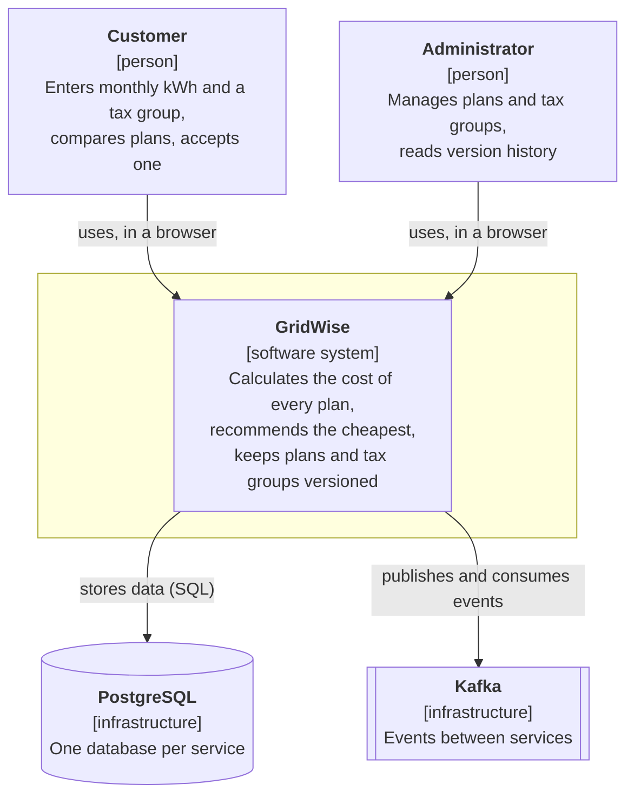
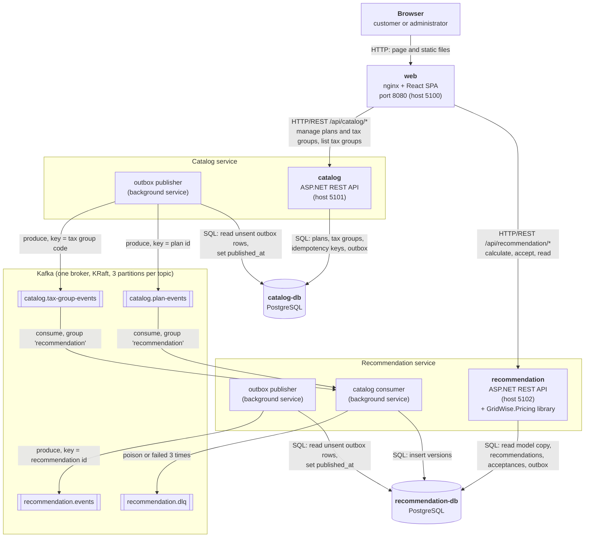

# GridWise architecture

This page shows the system as it runs today (`docker compose up`): what it is made of, what each part owns,
and how the parts talk to each other. Everything here is taken from the code and `compose.yaml`.

- Data model of each database: [data-model.md](data-model.md)
- Sequence diagrams of the main flows: [flows.md](flows.md)
- Decisions behind the design: [../decisions/](../decisions/), especially
  [0008 service boundaries](../decisions/0008-service-boundaries.md),
  [0009 synchronous vs asynchronous communication](../decisions/0009-sync-vs-async.md) and
  [0005 outbox, topics and events](../decisions/0005-outbox-and-events.md)
- Event contracts: [../events/README.md](../events/README.md)

## Context

Two kinds of people use GridWise. Customers ask which electricity billing plan is cheapest for their consumption.
Administrators keep the plans and tax groups up to date. GridWise has no external systems: it depends only on
infrastructure that runs next to it (PostgreSQL for data, Kafka for events).

## Containers

`kafka-init` is a one-shot container that creates the four topics before `catalog` and `recommendation` start
(automatic topic creation is off). It is not drawn.

### web

Responsibility: serves the React single-page app and is the only address the browser needs. nginx
(`nginxinc/nginx-unprivileged`, port 8080) serves the static files and forwards `/api/catalog/*` and `/api/recommendation/*`
to the two services, removing the prefix. It owns no data. The app has a customer page (calculate, compare, accept) and an
admin page (plans and tax groups: create, new version, retire, history). It reads the tax group list from the catalog and
does all other customer calls against the recommendation service. nginx is a plain reverse proxy: it does no authentication,
rate limiting or token checks.

### catalog and catalog-db

Responsibility: the source of truth for plans and tax groups. A change never edits a row: it adds a new version
(or a "retired" version) with an effective date. It owns the `catalog` database: plans, tax groups, all their versions and
tiers, idempotency keys and the outbox. It talks to others in one way only: it writes an outbox row in the same transaction
as the change, and its publisher sends that row to Kafka afterwards. Concurrent edits are guarded by `If-Match` plus the
primary key of the version; repeating a create is guarded by `Idempotency-Key`. It never calls the recommendation service
and never reads Kafka. Sample data (Standard, Premium, household, business) is inserted by a migration, together with
outbox rows, so it reaches the recommendation service through the same event path.

### recommendation and recommendation-db

Responsibility: calculating, storing and accepting recommendations. It owns the `recommendation` database: its own
copy of plan and tax group versions (the read model), the recommendations, the acceptances and an outbox.
A request is answered from this database only, and the pricing rules come from the `GridWise.Pricing` library, which has no
dependency on the database or on Kafka. Each stored recommendation keeps the plan and tax group versions it used.
The copy is filled by the catalog consumer; a new, empty database fills itself because the consumer reads the catalog
topics from the beginning. The service also has a one-off command, `reprocess-dlq`, that reads `recommendation.dlq`.

### Kafka and the topics

One broker (KRaft, replication factor 1), automatic topic creation off, 3 partitions per topic. Messages are JSON
envelopes (`id`, `type`, `version`, `timestamp`, `correlationId`, `data`).

| Topic | Key | Producer | Consumer | Retention |
|---|---|---|---|---|
| `catalog.plan-events` | plan id | catalog (outbox publisher) | recommendation (group `recommendation`) | no expiry |
| `catalog.tax-group-events` | tax group code | catalog (outbox publisher) | recommendation (group `recommendation`) | no expiry |
| `recommendation.events` | recommendation id | recommendation (outbox publisher) | none yet | no expiry |
| `recommendation.dlq` | key of the original message | recommendation (consumer, and `reprocess-dlq`) | `reprocess-dlq` command (manual) | default |

Delivery is at least once. The consumer is idempotent, and the same key always goes to the same partition, so the versions
of one plan arrive in order. The event formats are in [../events/README.md](../events/README.md).

### Outbox publishers and the consumer

These are background services inside the two applications, not separate containers.

- **Outbox publisher** (one in catalog, one in recommendation): every second it reads up to 100 rows with
  `published_at IS NULL` in order of creation, produces them to Kafka (`acks=all`, idempotent producer), and then sets
  `published_at`. If Kafka is down the rows wait and the publisher tries again every 5 seconds. A crash between the send and
  `published_at` can send a row twice, which is why consumers must be idempotent. Published rows older than 7 days are
  deleted by an hourly cleanup job (catalog also deletes idempotency keys older than 24 hours).
- **Catalog consumer** (in recommendation): reads the two catalog topics with auto-commit off. It inserts each version with
  `ON CONFLICT DO NOTHING` and commits the offset only after that write. A poison message (not valid JSON, not an envelope,
  unreadable data, or a version of the event it does not support) goes to `recommendation.dlq` at once; an unknown event type is skipped;
  other failures are tried 3 times and then dead-lettered; a database outage is waited out without committing.
