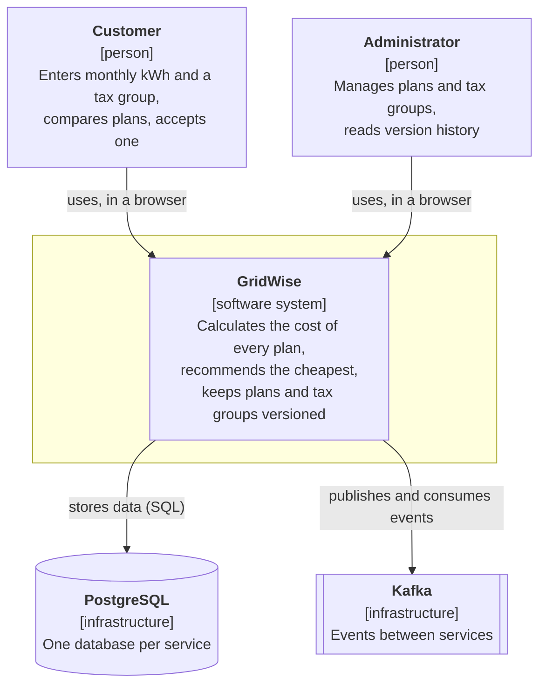
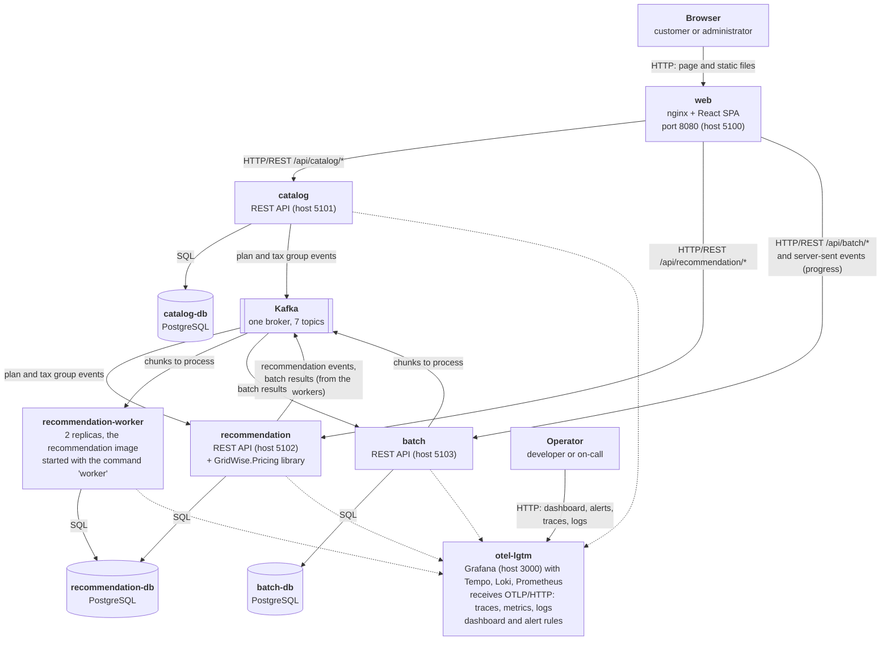
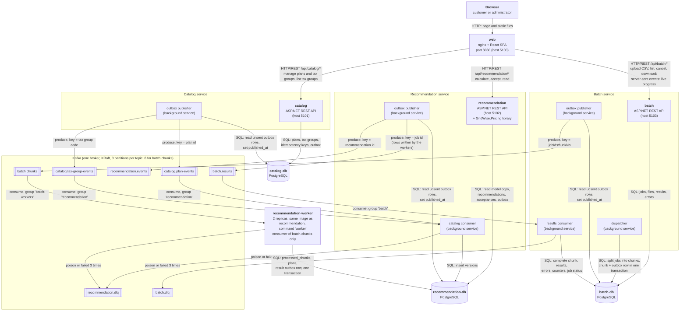

# GridWise architecture

This page shows the system as it runs today (`docker compose up`): what it is made of, what each part owns,
and how the parts talk to each other. Everything here is taken from the code and `compose.yaml`.

- Data model of each database: [data-model.md](data-model.md)
- Sequence diagrams of the main flows: [flows.md](flows.md)
- Throughput and resilience of the batch module: [../perf/README.md](../perf/README.md)
- Decisions behind the design: [../decisions/](../decisions/), especially
  [0011 batch processing](../decisions/0011-batch-processing.md),
  [0008 service boundaries](../decisions/0008-service-boundaries.md),
  [0009 synchronous vs asynchronous communication](../decisions/0009-sync-vs-async.md) and
  [0005 outbox, topics and events](../decisions/0005-outbox-and-events.md)
- Event contracts: [../events/README.md](../events/README.md)

## Context

Two kinds of people use GridWise. Customers ask which electricity billing plan is cheapest for their consumption.
Administrators keep the plans and tax groups up to date. GridWise has no external systems: it depends only on
infrastructure that runs next to it (PostgreSQL for data, Kafka for events).

## Containers

The containers and who talks to whom. Kafka is one box here; the next diagram opens it up.

`otel-lgtm` receives the traces, metrics and logs of the four .NET containers (dashed lines). Nothing depends on it: the services
keep working when it is stopped. Its dashboard and alert rules come from `observability/grafana`; see [operations](../operations.md).

## Background services and topics

Inside the services, background services move data between the databases and Kafka: a service writes an outbox row in the
same transaction as its change, and its publisher sends the row to Kafka afterwards. This diagram shows them with the topics,
their keys and the consumer groups.

`kafka-init` is a one-shot container that creates the seven topics before `catalog`, `recommendation` and `batch` start
(automatic topic creation is off). It is not drawn.

### web

Responsibility: serves the React single-page app and is the only address the browser needs. nginx
(`nginxinc/nginx-unprivileged`, port 8080) serves the static files and forwards `/api/catalog/*`, `/api/recommendation/*` and
`/api/batch/*` to the three services, removing the prefix. The progress stream of a batch job (`/api/batch/jobs/{id}/events`) has its own
nginx location with buffering off and a one-hour read timeout. It owns no data. The app has a customer page (calculate, compare, accept) and an
admin page (plans and tax groups: create, new version, retire, history; and batch: upload a CSV, watch the progress, cancel, download
results). It reads the tax group list from the catalog, talks to batch for the batch page and does all other customer calls against
the recommendation service. nginx is a plain reverse proxy: it does no authentication,
rate limiting or token checks.

### catalog and catalog-db

Responsibility: the source of truth for plans and tax groups. A change never edits a row: it adds a new version
(or a "retired" version) with an effective date. It owns the `catalog` database: plans, tax groups, all their versions and
tiers, idempotency keys and the outbox. It talks to others in one way only: it writes an outbox row in the same transaction
as the change, and its publisher sends that row to Kafka afterwards. Concurrent edits are guarded by `If-Match` plus the
primary key of the version; repeating a create is guarded by `Idempotency-Key`. It never calls the recommendation service
and never reads Kafka. Sample data (Standard, Premium, household, business) is inserted by a migration, together with
outbox rows, so it reaches the recommendation service through the same event path.

### recommendation and recommendation-db

Responsibility: calculating, storing and accepting recommendations. It owns the `recommendation` database: its own
copy of plan and tax group versions (the read model), the recommendations, the acceptances and an outbox.
A request is answered from this database only, and the pricing rules come from the `GridWise.Pricing` library, which has no
dependency on the database or on Kafka. Each stored recommendation keeps the plan and tax group versions it used.
The copy is filled by the catalog consumer; a new, empty database fills itself because the consumer reads the catalog
topics from the beginning. The service also has a one-off command, `reprocess-dlq`, that reads `recommendation.dlq`.

### batch and batch-db

Responsibility: running a CSV of up to 100,000 customers through the pricing rules without keeping the caller waiting. The upload
checks only what is instant (header `customer_id,consumption_kwh,tax_group`, 1 to 100,000 data rows, lines of at most 200 characters,
at most 10 MB), stores the job and its file in one transaction and answers `202 Accepted`. It owns the `batch` database: jobs, the
uploaded files, the chunks of each job, the results and errors per row, and an outbox. It also serves the job list and detail, the
cancel request, the live progress (server-sent events: the full state is sent at once and on every change) and the two CSV downloads
(results and errors, for Completed and Cancelled jobs). It never calls the recommendation service: it sends work through Kafka and gets
the answers from Kafka ([ADR 0011](../decisions/0011-batch-processing.md)). It assumes one instance. Its background services:

- **Dispatcher** (every second): splits a Pending job into chunks of 500 data rows and sets it Running (one transaction), then for a
  Running job sends the next Pending chunks while fewer than 20 of its chunks are Dispatched. Each chunk is marked Dispatched together with its
  outbox row (`BatchChunkRequested`, which carries the raw lines). Both steps lock the job row and check its status again, so a cancel
  and a dispatch cannot interleave. Chunk size and window come from configuration (`Batch:ChunkSize`, `Batch:WindowSize`).
- **Outbox publisher**: the same design as in the other services; key = `{jobId}:{chunkNo}`, so the chunks of one job spread over all
  6 partitions and several workers can process the same job.
- **Results consumer** (group `batch`): for each `BatchChunkCompleted`, in one transaction, it locks the job row, marks the chunk
  Completed (only if it was Dispatched, which makes a repeated message harmless), stores the results and errors, adds their counts to
  the job and completes the job when its last chunk is Completed. Results for a Cancelled job are ignored. A poison message goes to
  `batch.dlq`, a database outage is waited out, other failures are tried 3 times. The command `reprocess-dlq` reads `batch.dlq`.

### recommendation-worker

Responsibility: pricing the rows of one chunk at a time. It is not a separate codebase: it is the recommendation image started with
the command `worker` (compose runs 2 replicas). It starts only a consumer of `batch.chunks` (group `batch-workers`, auto-commit off):
no HTTP server, no migrations and no outbox publisher. For each chunk, in one transaction on the recommendation database, it inserts the
chunk into `processed_chunks` (`ON CONFLICT DO NOTHING`: a chunk that is already there is a duplicate and nothing more is written),
loads the active plans once, parses and validates every line, prices it with the same component as the REST API and adds one outbox row
`BatchChunkCompleted` with the results and the per-row errors. Only then is the offset committed. The recommendation service publishes that
outbox row to `batch.results`. If there are no active plans yet, the chunk is retried later without writing anything.

### Kafka and the topics

One broker (KRaft, replication factor 1), automatic topic creation off, 3 partitions per topic (`batch.chunks` has 6). Messages are JSON
envelopes (`id`, `type`, `version`, `timestamp`, `correlationId`, `data`).

| Topic | Key | Producer | Consumer | Retention |
|---|---|---|---|---|
| `catalog.plan-events` | plan id | catalog (outbox publisher) | recommendation (group `recommendation`) | no expiry |
| `catalog.tax-group-events` | tax group code | catalog (outbox publisher) | recommendation (group `recommendation`) | no expiry |
| `recommendation.events` | recommendation id | recommendation (outbox publisher) | none yet | no expiry |
| `recommendation.dlq` | key of the original message | recommendation (catalog consumer, and `reprocess-dlq`), recommendation-worker | `reprocess-dlq` command (manual) | default |
| `batch.chunks` | `{jobId}:{chunkNo}` | batch (outbox publisher) | recommendation-worker (group `batch-workers`) | no expiry |
| `batch.results` | job id | recommendation (outbox publisher; the rows are written by the workers) | batch (group `batch`) | no expiry |
| `batch.dlq` | key of the original message | batch (results consumer, and `reprocess-dlq`) | `reprocess-dlq` command of batch (manual) | default |

Delivery is at least once. The consumers are idempotent. For the catalog topics the same key always goes to the same partition, so the versions
of one plan arrive in order; the batch topics need no order, a result is applied by (job, chunk) whenever it arrives. The event formats are in [../events/README.md](../events/README.md).

### Outbox publishers and the consumer

These are background services inside the applications (the worker is its own container, see above), not separate containers.

- **Outbox publisher** (one in catalog, recommendation and batch): every second it reads up to 100 rows with
  `published_at IS NULL` in order of creation, produces them to Kafka (`acks=all`, idempotent producer), and then sets
  `published_at`. If Kafka is down the rows wait and the publisher tries again every 5 seconds. A crash between the send and
  `published_at` can send a row twice, which is why consumers must be idempotent. Published rows older than 7 days are
  deleted by an hourly cleanup job (catalog also deletes idempotency keys older than 24 hours).
- **Catalog consumer** (in recommendation): reads the two catalog topics with auto-commit off. It inserts each version with
  `ON CONFLICT DO NOTHING` and commits the offset only after that write. A poison message (not valid JSON, not an envelope,
  unreadable data, or a version of the event it does not support) goes to `recommendation.dlq` at once; an unknown event type is skipped;
  other failures are tried 3 times and then dead-lettered; a database outage is waited out without committing.
