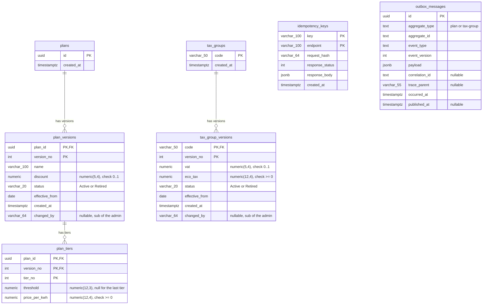
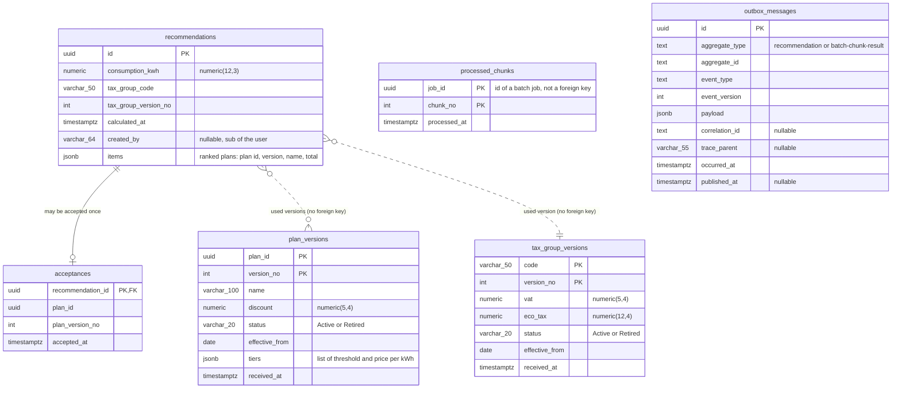
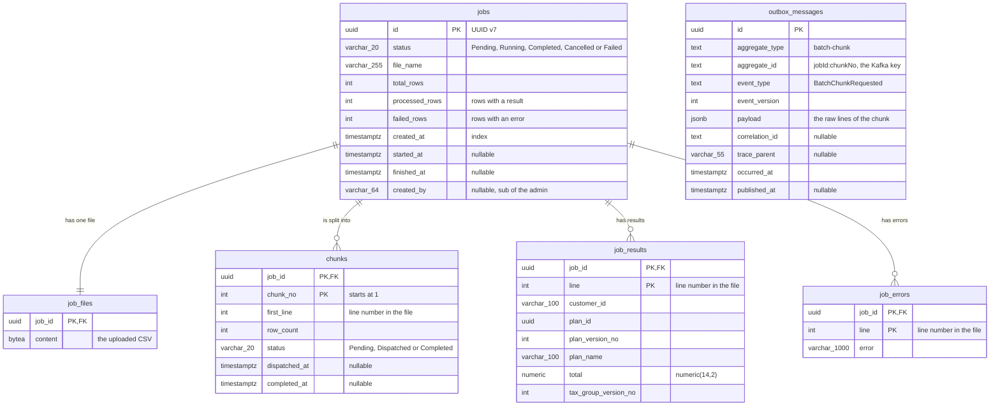

# Data model

Each service has its own PostgreSQL database (three: `catalog`, `recommendation`, `batch`) and nobody else reads or writes it
([ADR 0008](../decisions/0008-service-boundaries.md)). Tables and columns come from the EF Core configurations and the migrations
(`src/GridWise.*/Data/Configurations`, `src/GridWise.*/Migrations`); column names are snake_case.
`numeric(p,s)` precisions are in the column comments. Back to [architecture](README.md).

## Catalog database (`catalog`)

The source of truth for plans and tax groups. Identity and versions are separate: `plans` and `tax_groups` hold only the key,
everything that changes is in an immutable version row.

| Table | Purpose and notable constraints |
|---|---|
| `plans` | Identity of a plan (a uuid). Nothing else about the plan lives here. |
| `plan_versions` | One row per version of a plan: name, discount, status and the date it takes effect. The primary key `(plan_id, version_no)` is also the optimistic concurrency guard: two editors that both create version N+1 collide on it and the second gets 409. Versions are immutable (the code only inserts them, and the foreign keys use `ON DELETE RESTRICT`). A retirement is a new version with status `Retired` and no tiers. `status` is stored as text (`Active` / `Retired`). Check constraint `ck_plan_versions_discount`: discount between 0 and 1 (a fraction, 0.05 = 5 %). `changed_by` (`varchar(64)`, nullable, migration `AddChangedBy`): the `sub` claim of the token of the admin who made the version (creation, new version or retirement), set by the catalog endpoints from the signed-in user; `NULL` for the seed data. It is also sent as the optional field `changedBy` of `PlanVersionCreated` ([events](../events/README.md#who-made-a-change-changedby-and-no-tokens-in-events)). |
| `plan_tiers` | The pricing tiers of one plan version. Primary key `(plan_id, version_no, tier_no)`; the foreign key to `plan_versions` uses `ON DELETE RESTRICT`. `threshold` is the upper limit in kWh and is `NULL` for the last tier; the rule "exactly one tier without a limit, and it is the last" is checked by the domain rules, not by the database. Check constraint `ck_plan_tiers_price_per_kwh`: price >= 0. |
| `tax_groups` | Identity of a tax group (`code`, such as `household`). |
| `tax_group_versions` | Versions of a tax group: VAT rate and eco tax per kWh. Same rules as plan versions: primary key `(code, version_no)` is the concurrency guard, rows are immutable, the foreign key restricts deletes. Check constraints `ck_tax_group_versions_vat` (0..1) and `ck_tax_group_versions_eco_tax` (>= 0). `changed_by` as in `plan_versions` (same migration), sent as `changedBy` of `TaxGroupVersionCreated`. |
| `idempotency_keys` | Makes a repeated plan creation return the stored answer. Primary key `(key, endpoint)`. `request_hash` (SHA-256 as 64 characters) detects the same key sent with a different body (rejected); the first response is kept in `response_status` and `response_body` (jsonb). Rows older than 24 hours are deleted hourly. |
| `outbox_messages` | The transactional outbox: written in the same transaction as the data change, sent to Kafka afterwards. `id` becomes the event id in the envelope. `aggregate_id` becomes the Kafka key and `aggregate_type` picks the topic. `payload` is the event data (jsonb). `trace_parent` (`varchar(55)`, nullable, migration `AddOutboxTraceParent`) is the W3C traceparent of the request that wrote the row; the publisher continues that trace, so the Kafka message belongs to the same trace. Filtered index `ix_outbox_messages_occurred_at` on `occurred_at` `WHERE published_at IS NULL` keeps the publisher's query small however many sent rows there are. Sent rows older than 7 days are deleted hourly. |

The migration `SeedSampleData` inserts the sample plans and tax groups (and their outbox rows) with the schema.

## Recommendation database (`recommendation`)

Holds a copy of the catalog versions (the read model), the calculated recommendations and the acceptances.
The copy is written only by the catalog consumer and is never changed afterwards.

| Table | Purpose and notable constraints |
|---|---|
| `plan_versions` | Copy of every plan version received from `catalog.plan-events`, including future and retired versions. Same primary key as in the catalog, `(plan_id, version_no)`: the consumer inserts with `ON CONFLICT DO NOTHING`, so a duplicate or out-of-order event cannot change or corrupt the copy. The tiers are one `jsonb` column because the copy is always read whole and never changed. `received_at` is when this service stored it. There are no foreign keys: this table has no parent. The version used for a request is the one with the latest `effective_from` up to today, per plan. |
| `tax_group_versions` | The same for tax groups, filled from `catalog.tax-group-events`. Primary key `(code, version_no)`. |
| `recommendations` | One row per calculation. It records the consumption, the tax group code and version used, and `items` (jsonb): the ranked list of plan id, plan version, name and total, which gives the plan versions used. The per-tier breakdown is not stored; it is recalculated on read from the stored versions ([ADR 0007](../decisions/0007-recommendation-durability-and-storage.md)). A row is never updated. `created_by` (`varchar(64)`, nullable, migration `AddRecommendationCreatedBy`) is the `sub` of the user who calculated it: only that user may accept it, and a customer reads only their own (someone else's answers 404, so its existence is not revealed); an admin may read any. The links to the plan and tax group versions are logical (`tax_group_code` + `tax_group_version_no`, plan ids inside `items`), not foreign keys. |
| `acceptances` | At most one per recommendation: the primary key is `recommendation_id`, which is also a foreign key to `recommendations` (`ON DELETE RESTRICT`). Two parallel accepts collide on the key; the loser reads the winner's row and gets 200 (same plan) or 409 (another plan). It stores the accepted plan and its version number. |
| `processed_chunks` | Written only by the batch workers: one row for every chunk of a batch job that was priced. Primary key `(job_id, chunk_no)`. A worker inserts it with `ON CONFLICT DO NOTHING` as the first step of the chunk's transaction: when no row is inserted the chunk was already processed, and nothing else is written. The row exists only if the transaction commits, together with the result's outbox row, so a worker killed mid-chunk leaves nothing behind. `job_id` points to a job in the batch database, so it is not a foreign key. |
| `outbox_messages` | The same outbox structure as in the catalog, for `RecommendationCalculated` and `PlanAccepted` (aggregate type `recommendation`) and for `BatchChunkCompleted` (aggregate type `batch-chunk-result`, key = job id, written by the workers), with the same `trace_parent` column and filtered index `ix_outbox_messages_occurred_at` (`WHERE published_at IS NULL`). A recommendation or acceptance row is saved in the same transaction as its outbox row. Recommendations are saved with `synchronous_commit` off (ADR 0007): if the database crashes the row and its event are lost together, so the data stays consistent. |

## Batch database (`batch`)

Owned by the batch service. A job is an uploaded file; it is split into chunks, and the answers come back as results and errors per row.
The tables are in `src/GridWise.Batch/Data/Configurations` and `src/GridWise.Batch/Migrations`.

| Table | Purpose and notable constraints |
|---|---|
| `jobs` | One row per upload. `status` is stored as text. `created_by` (`varchar(64)`, nullable, migration `AddJobCreatedBy`) is the `sub` of the admin who uploaded the file; it is recorded only, not used for access (every admin sees every job). `total_rows` is counted at upload; `processed_rows` and `failed_rows` grow as results arrive, so they add up to `total_rows` when the job is Completed. The row is locked (`SELECT ... FOR UPDATE`) by the dispatcher, the results consumer and the cancel request, which is what keeps them from interleaving. Foreign keys from the other tables are `ON DELETE RESTRICT`; nothing deletes jobs yet. The list is read with the index on `created_at`. |
| `job_files` | The uploaded CSV as `bytea`, in its own table so that listing jobs never touches the file. It is written in the same transaction as the job and read by the dispatcher (to split the job and to cut the lines of each chunk). It is kept after the job ends. |
| `chunks` | The pieces of a job (500 data rows each by default), created all at once when the job starts. `first_line` and `row_count` say which lines belong to the chunk; blank lines are not counted in `row_count` but are counted in line numbers. `status`: Pending (not sent), Dispatched (its outbox row was written in the same transaction as this status) and Completed (its result arrived). The update to Completed is conditional on Dispatched, which makes a repeated result harmless. The window of 20 is the number of Dispatched chunks of a job. |
| `job_results` | The cheapest plan for each valid row, with the plan version and tax group version that were used. Primary key `(job_id, line)`, so a line cannot be stored twice. Written in the same transaction that completes the chunk. |
| `job_errors` | The reason each invalid row was rejected, with the same key. Invalid rows never stop a chunk or the job. |
| `outbox_messages` | The same structure (including `trace_parent`) and filtered index as in the other services, for `BatchChunkRequested`. `aggregate_id` is `{jobId}:{chunkNo}` and becomes the Kafka key. A chunk is marked Dispatched and gets its outbox row in one transaction. Published rows older than 7 days are deleted by an hourly job. |
