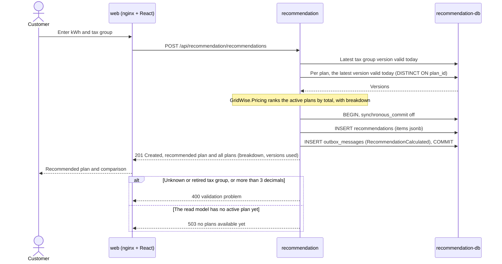
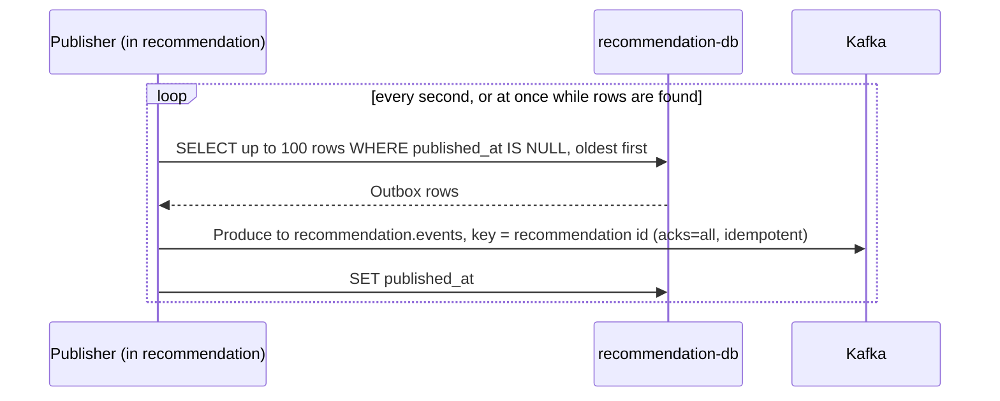
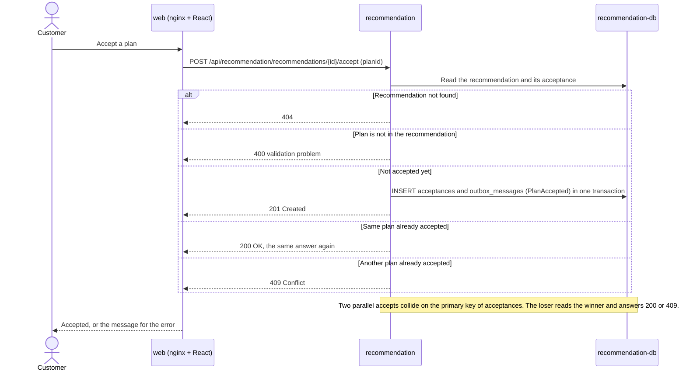
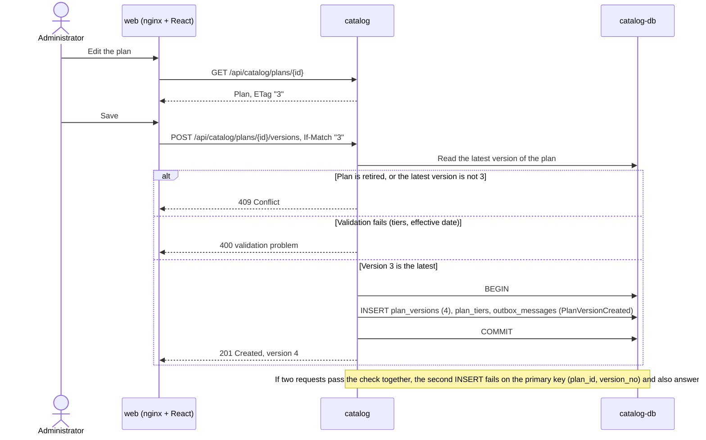
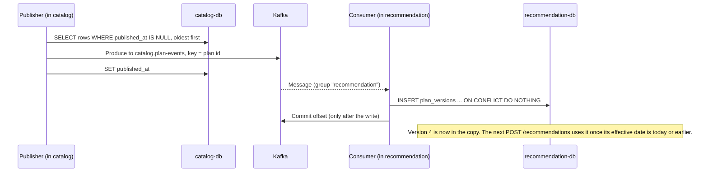
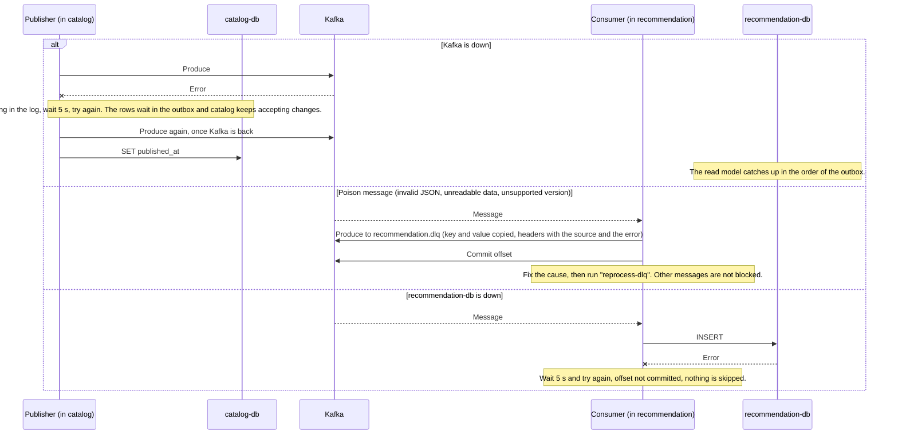
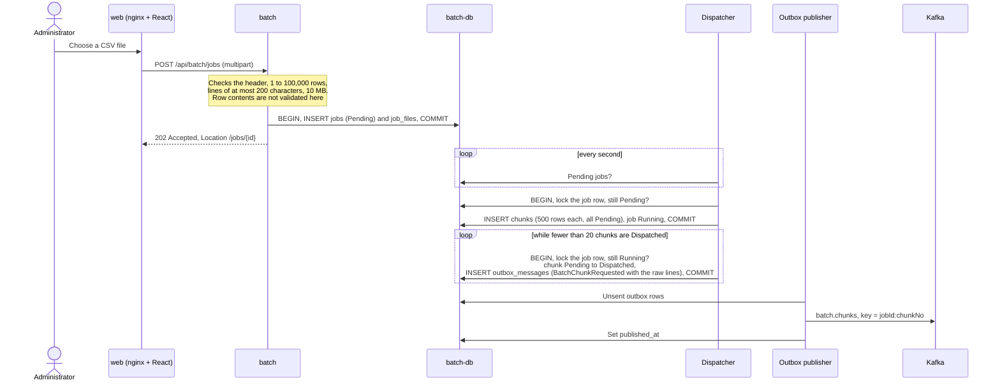
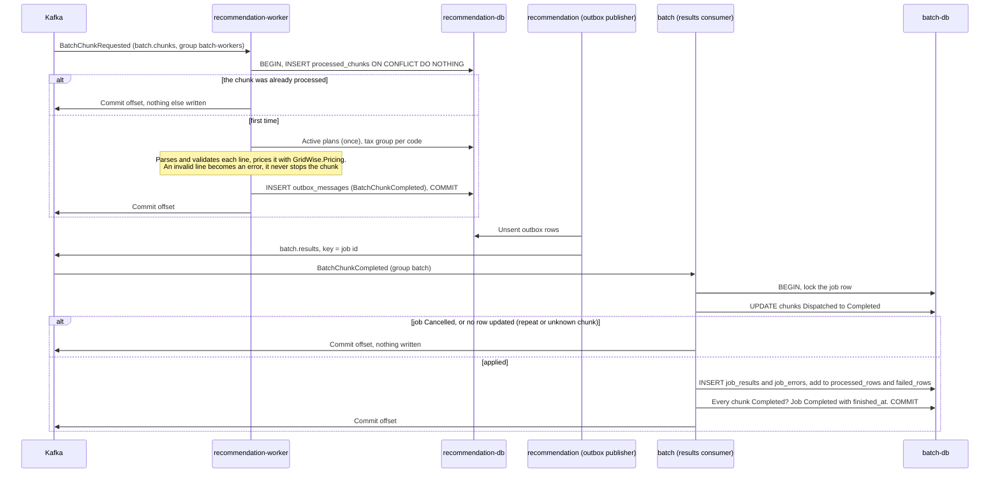
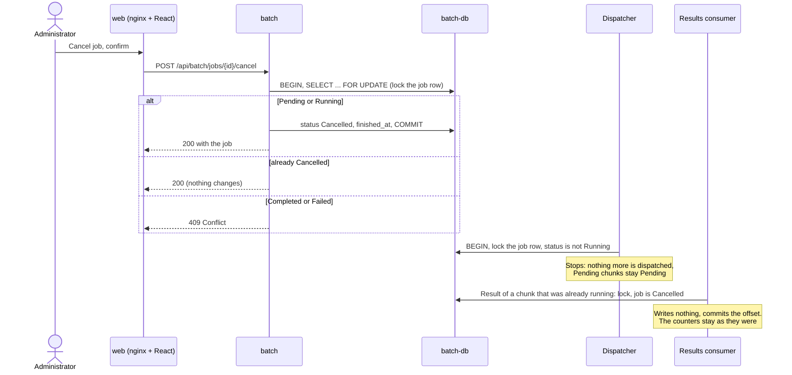
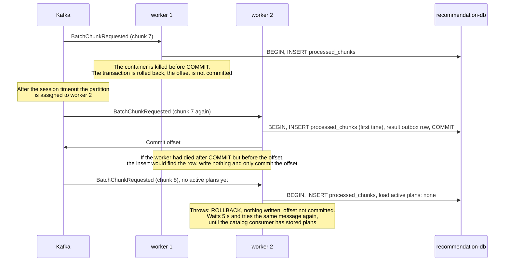

# Main flows

Sequence diagrams of the main flows. Each flow is split so that every diagram stays small.
Participants are the containers from the [architecture overview](README.md); "Publisher" and "Consumer" are background
services inside the Catalog, Recommendation and Batch applications. Table names are in [data-model.md](data-model.md).

## 1. Getting a recommendation

### 1a. Calculating (synchronous)

The request is answered from the recommendation database alone: the service never calls the catalog.
The result and its event are saved in one transaction.

### 1b. Publishing the event (asynchronous)

If Kafka is unavailable the produce call fails, the publisher logs a warning, waits 5 seconds and tries again. The rows stay in
the outbox and the customer is not affected. If the service stops between the produce call and `published_at`, the row is sent
again later (delivery is at least once).

### 1c. Accepting a plan

The `PlanAccepted` event is sent by the same publisher as in 1b.

## 2. Propagating a plan change

### 2a. Changing the plan (synchronous, catalog only)

### 2b. Reaching the read model (asynchronous)

### 2c. When something goes wrong

A message that fails for another reason is tried 3 times before it goes to the dead-letter topic.
A message of an unknown event type is skipped and its offset is committed.

## 3. Batch job

The administrator uploads a CSV of customers (for example 100,000 rows). The answer comes at once, the work happens in the background,
and the page follows the progress. The design is in [ADR 0011](../decisions/0011-batch-processing.md).

### 3a. Upload and dispatch

The upload checks only what is instant. The job is split into chunks and sent to the workers a few at a time: at most 20 chunks of a job
are Dispatched (not yet Completed) at once.

### 3b. Worker and results

A worker prices a chunk and writes the answer to its own outbox, in one transaction; the recommendation service publishes it and
Batch stores it. When a result frees a window slot, the dispatcher of 3a sends the next chunk.

The page reads the progress from `GET /api/batch/jobs/{id}/events` (server-sent events): the current state at once and a new event
whenever the database changes (it is checked every 500 ms), a heartbeat comment every 15 seconds, and a final event when the job is
Completed, Cancelled or Failed. Every event carries the full state, so a client that reconnects simply continues from the current state.

### 3c. Cancelling and failures

Cancelling a job. The job row lock is the same one the dispatcher and the results consumer take, so a cancel cannot interleave with them.

An unknown job gets 404. The results and errors written before the cancel stay and can be downloaded as CSV (partial results).

Failures. Nothing is lost and nothing is counted twice, because a chunk's rows exist only if its transaction commits and
`processed_chunks` has one row per chunk. This is checked by [`scripts/resilience-batch-worker.sh`](../../scripts/resilience-batch-worker.sh),
which kills a worker during a 100,000-row job (see [../perf/README.md](../perf/README.md)).

A message that cannot be read, or that still fails after 3 attempts, goes to `recommendation.dlq` (a chunk) or `batch.dlq`
(a result); a database outage is waited out without counting an attempt. `reprocess-dlq` of each service reads its dead-letter topic
again after the cause is fixed (see [../events/README.md](../events/README.md)).
