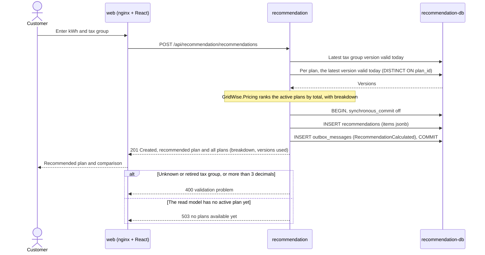
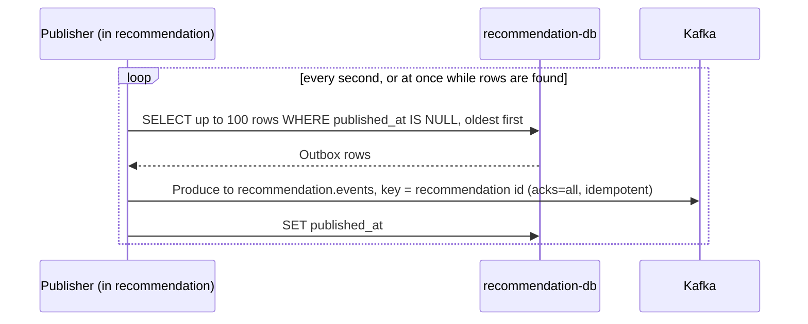
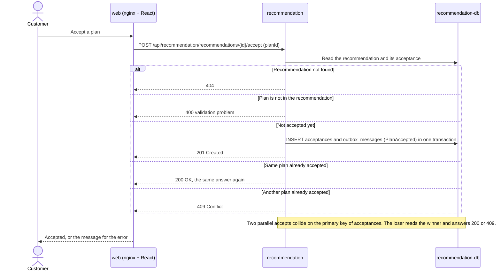
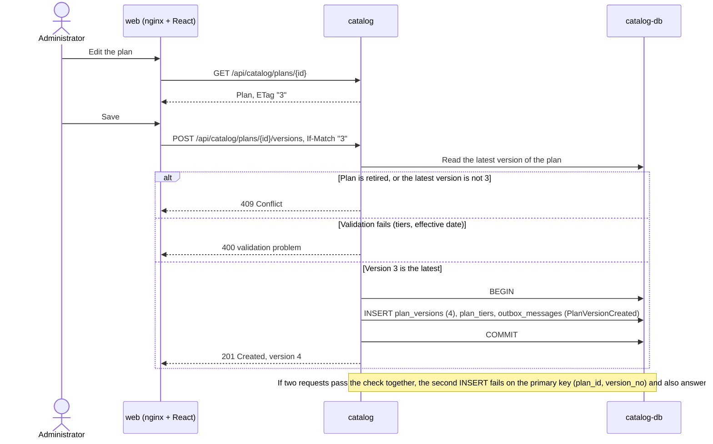
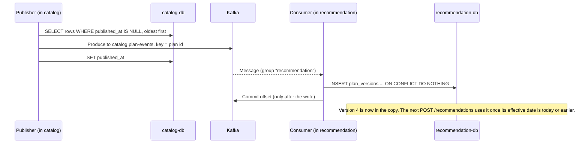
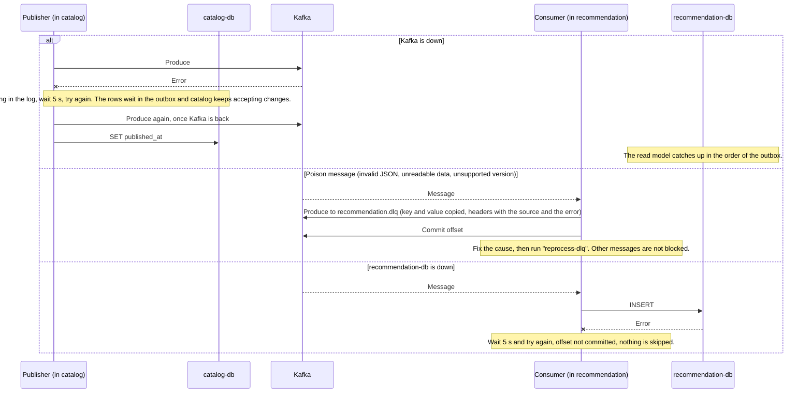

# Main flows

Sequence diagrams of the two main flows. Each flow is split so that every diagram stays small.
Participants are the containers from the [architecture overview](README.md); "Publisher" and "Consumer" are background
services inside the Catalog and Recommendation applications. Table names are in [data-model.md](data-model.md).

## 1. Getting a recommendation

### 1a. Calculating (synchronous)

The request is answered from the recommendation database alone: the service never calls the catalog.
The result and its event are saved in one transaction.

### 1b. Publishing the event (asynchronous)

If Kafka is unavailable the produce call fails, the publisher logs a warning, waits 5 seconds and tries again. The rows stay in
the outbox and the customer is not affected. If the service stops between the produce call and `published_at`, the row is sent
again later (delivery is at least once).

### 1c. Accepting a plan

The `PlanAccepted` event is sent by the same publisher as in 1b.

## 2. Propagating a plan change

### 2a. Changing the plan (synchronous, catalog only)

### 2b. Reaching the read model (asynchronous)

### 2c. When something goes wrong

A message that fails for another reason is tried 3 times before it goes to the dead-letter topic.
A message of an unknown event type is skipped and its offset is committed.
