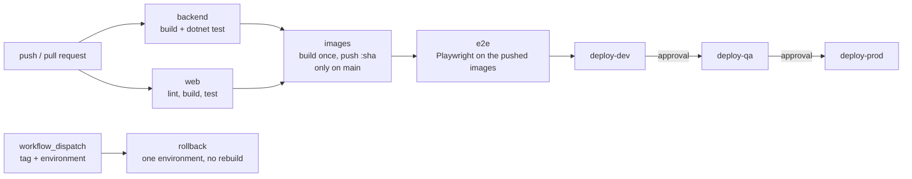

# Deployment

The pipeline is `.github/workflows/ci.yml`. The deployment steps are **simulated** on the CI runner (see the last section).
Local development is unchanged: `docker compose up -d --build` still builds the images and starts everything.

## Pipeline

- On every push and pull request only `backend` and `web` run.
- On a push to `main`, `images` and everything after it run too.
- `rollback` runs only when started by hand and then nothing else runs.

## Build once, deploy many

The four images (`catalog`, `recommendation`, `batch`, `web`) are built once, tagged with the commit SHA and pushed to
`ghcr.io/<owner>/gridwise/<service>:<sha>`. The worker is the `recommendation` image started with the command `worker`.
The e2e tests and all three environments run exactly these images. Nothing is rebuilt between environments.

| Never changes (in the image) | Changes per environment (`deploy/<env>.env` and secrets) |
|---|---|
| The code and its dependencies | `ASPNETCORE_ENVIRONMENT` (Development, Staging, Production) |
| The nginx configuration of `web` | `LOG_LEVEL` |
| The database migrations | Host ports |
| The service names and ports inside the network | Database passwords (GitHub secrets, never in a file) |

Compose names the images `${REGISTRY:-gridwise}/<service>:${TAG:-local}`. Locally that is `gridwise/<service>:local`, built by compose.
In CI `REGISTRY=ghcr.io/<owner>/gridwise` and `TAG=<sha>`, and the images are pulled (`docker compose pull`, then `up --no-build`).

## Promotion

`deploy-dev`, `deploy-qa` and `deploy-prod` each need the previous job, so a failed smoke test (health endpoints of the three
services, one recommendation for 250 kWh household) stops the promotion. Each job uses a GitHub environment of the same name.

Manual setup in GitHub (once per repository):

1. Settings → Environments → New environment: `dev`, `qa`, `prod`.
2. In `qa` and `prod`: tick **Required reviewers** and add the people who approve. A deploy job then waits for an approval before it starts.
   Optionally add a **Deployment branches** rule (`main` only) to all three.
3. In each environment add the secrets `CATALOG_DB_PASSWORD`, `RECOMMENDATION_DB_PASSWORD` and `BATCH_DB_PASSWORD`.
   Without a secret the job falls back to the dev default from `.env.example`, which is fine for `dev` and must not be accepted for `prod`.
4. Settings → Actions → General → Workflow permissions: leave the default read access. The jobs ask for `packages: write` / `read` themselves.
5. After the first run on `main` the packages `gridwise/*` appear under the owner. The jobs log in with `GITHUB_TOKEN`; if a pull is
   refused, open the package → Package settings → Manage Actions access and add this repository with read access.

## Rollback

Actions → CI/CD → **Run workflow**, with the input `tag` (the commit SHA of an earlier successful run on `main`) and `environment`.
Only the `rollback` job runs. It uses that environment (so its approvals and secrets apply), pulls the images of that SHA and
smoke-tests them. No build happens, so the images must still exist in the registry: do not delete old tags.
The compose file and the env files are taken from the branch the workflow is started on. Database migrations are not undone:
a rollback to a version older than the last migration needs a compatible schema (add columns in a backward-compatible way).

## What a real deployment would replace

The simulated step starts the stack on the runner with `docker compose up` and stops it after the smoke test. A real deployment would:

- Run the same images on a server (compose over SSH or a registry-pulling agent) or on Kubernetes (a Deployment per service with the
  image tag set to the SHA, `kubectl rollout status` instead of `--wait`, `kubectl rollout undo` or the same tag input for rollback).
- Use managed PostgreSQL and Kafka instead of the containers in the compose file, and apply migrations as a separate, controlled step.
- Read passwords from a secrets store (a cloud secret manager, Kubernetes Secrets with an external operator, Vault) instead of
  GitHub secrets copied into environment variables, and rotate them.
- Keep the environments running (this simulation tears them down), put a gateway and TLS in front of `web`, and add monitoring
  and alerts on the health endpoints.
