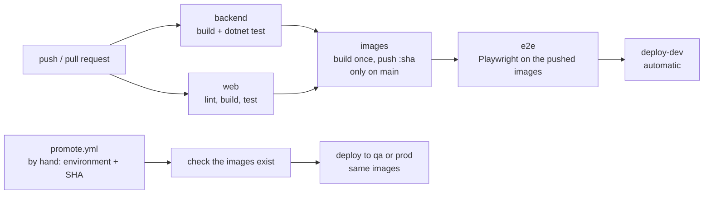

# Deployment

The pipeline is `.github/workflows/ci.yml`. The deployment steps are **simulated** on the CI runner (see the last section).
Local development is unchanged: `docker compose up -d --build` still builds the images and starts everything.

## Pipeline

- `ci.yml` runs on every push and pull request. Only `backend` and `web` run, except on `main`: there `images`, `e2e` and `deploy-dev` follow.
- `promote.yml` is started by hand and never builds anything.

## Build once, deploy many

The five images (`catalog`, `recommendation`, `batch`, `gateway`, `web`) are built once, tagged with the commit SHA and pushed to
`ghcr.io/<owner>/gridwise/<service>:<sha>`. The worker is the `recommendation` image started with the command `worker`.
The e2e tests and all three environments run exactly these images. Nothing is rebuilt between environments.

| Never changes (in the image) | Changes per environment (`deploy/<env>.env` and secrets) |
|---|---|
| The code and its dependencies | `ASPNETCORE_ENVIRONMENT` (Development, Staging, Production) |
| The nginx configuration of `web` | `LOG_LEVEL` |
| The database migrations | Host ports |
| The service names and ports inside the network | Database passwords (repository secrets, never in a file) |

Compose names the images `${REGISTRY:-gridwise}/<service>:${TAG:-local}`. Locally that is `gridwise/<service>:local`, built by compose.
In CI `REGISTRY=ghcr.io/<owner>/gridwise` and `TAG=<sha>`, and the images are pulled (`docker compose pull`, then `up --no-build`).

## Why there are no approval buttons

Required reviewers (a deploy waiting for someone to click Approve) belong to GitHub *environments*. Environments with required
reviewers and environment secrets are not available for **private repositories on the GitHub Free plan**, so this pipeline does not use them.
Instead `qa` and `prod` are deployed by a person starting `promote.yml`: the manual start is the approval, and who may start it is
decided by who has write access to the repository.

With a public repository or GitHub Enterprise, the change is small: give each deploy job `environment: <name>` (`dev`, `qa`, `prod`), add
required reviewers to `qa` and `prod` in Settings → Environments, and move the passwords to environment secrets named without the prefix
(`CATALOG_DB_PASSWORD`). The jobs could then be chained again (`deploy-qa` needs `deploy-dev`, `deploy-prod` needs `deploy-qa`), and the
pipeline would stop and wait for the approvals by itself. The images, the deploy action and the env files stay the same.

## Secrets

Set once in Settings → Secrets and variables → Actions → Repository secrets. The name starts with the environment:

| Environment | Secrets |
|---|---|
| dev | `DEV_CATALOG_DB_PASSWORD`, `DEV_RECOMMENDATION_DB_PASSWORD`, `DEV_BATCH_DB_PASSWORD`, `DEV_KAFKA_ADMIN_PASSWORD`, `DEV_KAFKA_CATALOG_PASSWORD`, `DEV_KAFKA_RECOMMENDATION_PASSWORD`, `DEV_KAFKA_BATCH_PASSWORD` |
| qa | `QA_CATALOG_DB_PASSWORD`, `QA_RECOMMENDATION_DB_PASSWORD`, `QA_BATCH_DB_PASSWORD`, `QA_KAFKA_ADMIN_PASSWORD`, `QA_KAFKA_CATALOG_PASSWORD`, `QA_KAFKA_RECOMMENDATION_PASSWORD`, `QA_KAFKA_BATCH_PASSWORD` |
| prod | `PROD_CATALOG_DB_PASSWORD`, `PROD_RECOMMENDATION_DB_PASSWORD`, `PROD_BATCH_DB_PASSWORD`, `PROD_KAFKA_ADMIN_PASSWORD`, `PROD_KAFKA_CATALOG_PASSWORD`, `PROD_KAFKA_RECOMMENDATION_PASSWORD`, `PROD_KAFKA_BATCH_PASSWORD` |

A secret that is not set falls back to the dev default from `.env.example`. That is fine for `dev`, and means `prod` runs with a known
password until its secrets are set, so set them before the first prod deployment. Repository secrets are visible to every workflow in
the repository, so they are only as protected as write access to it.

## Promote and roll back

Promotion and rollback are the same operation: deploying images that were already built. Promoting means deploying a newer SHA,
rolling back means deploying an older one.

1. Find the SHA: the commit of a successful `CI/CD` run on `main` (the full 40 characters; Actions → the run → the commit link).
2. Actions → **Promote** → Run workflow. Choose `environment` (`qa` or `prod`) and paste the SHA into `tag`.
3. The workflow checks that all five images for that SHA exist in ghcr.io (and fails with the missing names if not), pulls them,
   starts the stack with `deploy/<environment>.env`, runs the smoke test and stops it (the deployment is simulated).

Notes:
- Do not delete old image tags from the registry, or the rollback to them is not possible.
- The compose file, env files and deploy action come from the branch the workflow is started on (normally `main`), not from the old SHA.
- Two runs for the same environment queue one after the other.
- Database migrations are not undone: rolling back to a version older than the last migration needs a compatible schema
  (add columns in a backward-compatible way).

## Actions minutes (private repositories)

Workflows on a private repository use the monthly minutes of the plan (2,000 on Free, on standard Linux runners; storage for
artifacts and packages is limited too). Every push runs `backend` (the Testcontainers tests alone take about 5 minutes on a laptop) and `web`; a push
to `main` adds four image builds, `e2e` and `deploy-dev`. Check the real figures in the first runs (the estimate here is not measured). To stay within the limit:
open pull requests instead of pushing many small commits to branches, and keep the `gha` build cache (it makes the image builds shorter).
The usage is shown in Settings → Billing and plans. Public repositories do not use minutes for standard runners.

## What a real deployment would replace

The simulated step starts the stack on the runner with `docker compose up` and stops it after the smoke test. A real deployment would:

- Run the same images on a server (compose over SSH or a registry-pulling agent) or on Kubernetes (a Deployment per service with the
  image tag set to the SHA, `kubectl rollout status` instead of `--wait`, `kubectl rollout undo` or the same tag input for rollback).
- Add approval and traceability: GitHub environments with required reviewers where the plan allows, or a deployment tool that has them.
- Use managed PostgreSQL and Kafka instead of the containers in the compose file, and apply migrations as a separate, controlled step.
- Read passwords from a secrets store (a cloud secret manager, Kubernetes Secrets with an external operator, Vault) instead of
  repository secrets copied into environment variables, and rotate them.
- Keep the environments running (this simulation tears them down), put a gateway and TLS in front of `web`, and add monitoring
  and alerts on the health endpoints.
